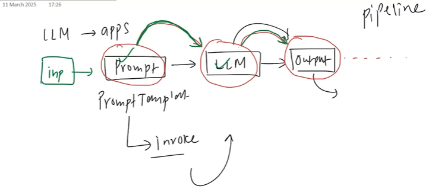

By using pipelines we actually save writing a lot of manual code.

Flow => pipe->inp->prompt->LLM->output->..
Chains are not limited to sinle line ..we can build complex Chains too.
We can do the follwoing op with chains:
    1) Seq chain,2) Parallel chain,3) Condictional chain.

